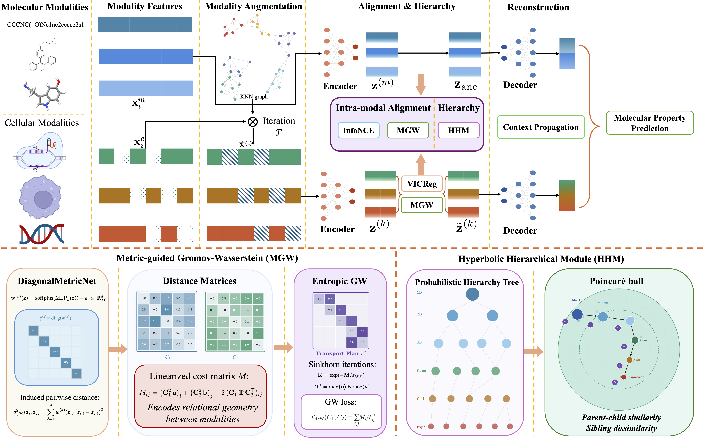

# GeoPMR: Preserving Relational and Hierarchical Geometry in Multimodal Molecular Representation Learning

**GeoPMR** is a geometry-aware hierarchical framework for multimodal molecular representations that addresses two structural properties: **geometric heterogeneity** and **hierarchical depth structure**. 


## Overview



## Installation

### Create and activate the environment

```bash
conda env create -f environment.yml
conda activate GeoPMR
```

## Datasets

To reproduce the reported results, the datasets used in this study is available on [Zenodo](https://zenodo.org/records/23905040) as **`raw_data.zip`**. The Zenodo link and DOI will be added upon publication of the data release.

### Prepared data archive

The prepared **`raw_data.zip`** archive contains the pretraining data and all seven downstream benchmark directories.

After obtaining the prepared archive, place it in the repository root and extract it there:

```bash
unzip raw_data.zip -d .
```

The resulting layout should be `GeoPMR/raw_data/pretrain/`:

```text
GeoPMR/
├── ckpt/
│   └── pretrain2D.pt
└── raw_data/
    ├── biogenadme/
    ├── broad6k/
    ├── chembl2k/
    ├── ogbg_molclintox/
    ├── ogbg_molhiv/
    ├── ogbg_molsider/
    ├── ogbg_moltoxcast/
    └── pretrain/
```

## Pretraining

```bash
python pretrain.py \
  --dataset pretrain \
  --model-path GeoPMR_biogenadme \
  --gpu-id 0 \
  --lr 1e-4 \
  --wdecay 1e-8 \
  --epochs 50 \
  --batch-size 3072 \
  --lambda_1 0.1 \
  --lambda_2 0.1 \
  --hierarchy-temperature 0.1 \
  --hierarchy-lambda-sim 0.25 \
  --hierarchy-lambda-dissim 0.125 \
  --mgw-alpha 0.5 \
  --mgw-alpha-aug 0.2 \
  --mgw-subsample 128 \
  --mgw-epsilon 0.1 \
  --mgw-outer-iters 3 \
  --mgw-sinkhorn-iters 20 \
  --mgw-learn-alpha \
  --mgw-alpha-max 1.0 \
  --learn-alignment-weights
```

## Downstream prediction

```bash
python finetune.py \
  --model-path GeoPMR_biogenadme.pt \
  --dataset finetune-biogenadme \
  --gpu-id 0 \
  --lr 2e-3 \
  --hidden 4 \
  --batch-size 5120 \
  --task_dropout 0.8 \
  --patience 50 \
  --epochs 300
```

### Benchmark hyperparameters

The following settings are reported for the seven benchmark datasets.

**Pretraining**
| Benchmark | Pretraining λ₁ | Pretraining λ₂ |
| --- | --- | --- |
| ChEMBL | 20 | 1 |
| ToxCast | 20 | 20 |
| Broad | 50 | 1 |
| ClinTox | 50 | 1 |
| SIDER | 20 | 0.01 |
| HIV | 20 | 0.01 |
| Biogen | 0.1 | 0.1 |

**Downstream prediction**

| Benchmark | Learning rate | Dropout | γ | Hidden size | Batch size | Patience | Epochs | Norm |
| --- | --- | --- | --- | --- | --- | --- | --- | --- |
| ChEMBL | 0.001 | 0.9 | None | 1800 | 5120 | 50 | 300 | LayerNorm |
| ToxCast | 0.01 | 0.8 | None | 1800 | 5120 | 50 | 300 | LayerNorm |
| Broad | 0.002 | 0.8 | None | 1800 | 2560 | 50 | 300 | LayerNorm |
| ClinTox | 0.005 | 0.9 | 0.01 | 2400 | 32 | 5 | 100 | LayerNorm |
| SIDER | 0.0005 | 0.2 | 0.1 | 1200 | 5120 | 20 | 30 | BatchNorm |
| HIV | 0.001 | 0.8 | 0.001 | 1800 | 10240 | 50 | 300 | BatchNorm |
| Biogen | 0.002 | 0.8 | None | 1200 | 5120 | 50 | 300 | LayerNorm |

### Downstream commands for the seven benchmarks.

```bash
# ChEMBL
python finetune.py --dataset finetune-chembl2k --model-path GeoPMR_chembl2k.pt \
  --lr 0.001 --task_dropout 0.9 --emb-dim 300 --hidden 6 \
  --batch-size 5120 --patience 50 --epochs 300

# ToxCast
python finetune.py --dataset finetune-moltoxcast --model-path GeoPMR_moltoxcast.pt \
  --lr 0.01 --task_dropout 0.8 --emb-dim 300 --hidden 6 \
  --batch-size 5120 --patience 50 --epochs 300

# Broad
python finetune.py --dataset finetune-broad6k --model-path GeoPMR_broad6k.pt \
  --lr 0.002 --task_dropout 0.8 --emb-dim 300 --hidden 6 \
  --batch-size 2560 --patience 50 --epochs 300

# ClinTox
python finetune.py --dataset finetune-molclintox --model-path GeoPMR_molclintox.pt \
  --lr 0.005 --task_dropout 0.9 --gamma 0.01 --emb-dim 300 --hidden 8 \
  --batch-size 32 --patience 5 --epochs 100

# SIDER
python finetune.py --dataset finetune-molsider --model-path GeoPMR_molsider.pt \
  --lr 0.0005 --task_dropout 0.2 --gamma 0.1 --emb-dim 300 --hidden 4 \
  --batch-size 5120 --patience 20 --epochs 30

# HIV
python finetune.py --dataset finetune-molhiv --model-path GeoPMR_molhiv.pt \
  --lr 0.001 --task_dropout 0.8 --gamma 0.001 --emb-dim 300 --hidden 6 \
  --batch-size 10240 --patience 50 --epochs 300

# Biogen
python finetune.py --dataset finetune-biogenadme --model-path GeoPMR_biogenadme.pt \
  --lr 0.002 --task_dropout 0.8 --emb-dim 300 --hidden 4 \
  --batch-size 5120 --patience 50 --epochs 300
```

### Random-forest predictions for selected OGB datasets

RF predictions are required by the current loader and prediction head for `molclintox`, `molhiv`, and `molsider`. The prepared data archive includes `raw/rf_pred.npy` for these datasets, so you can reuse the supplied predictions without retraining the RF models. The steps below describe how to regenerate them.

For example,

```bash
python random_forest/extract_fingerprint.py --dataset_name ogbg-molsider
python random_forest/random_forest.py --dataset_name ogbg-molsider
```

The scripts write features under `raw_data/ogbg_molsider/` and predictions to `raw_data/ogbg_molsider/raw/rf_pred.npy`.

## Citation

If you find this work useful, please cite our paper:
```bibtex
@inproceedings{zheng2026muss,
  title = {GeoPMR: Preserving Relational and Hierarchical Geometry in Multimodal Molecular Representation Learning},
  author = {Lusheng Li and Menglin Yang},
  booktitle = {Advances in Neural Information Processing Systems (NeurIPS)},
  year = {2026}
}
```

## Acknowledgements

This implementation builds on prior multimodal molecular representation work, including InfoAlign and CHMR.
